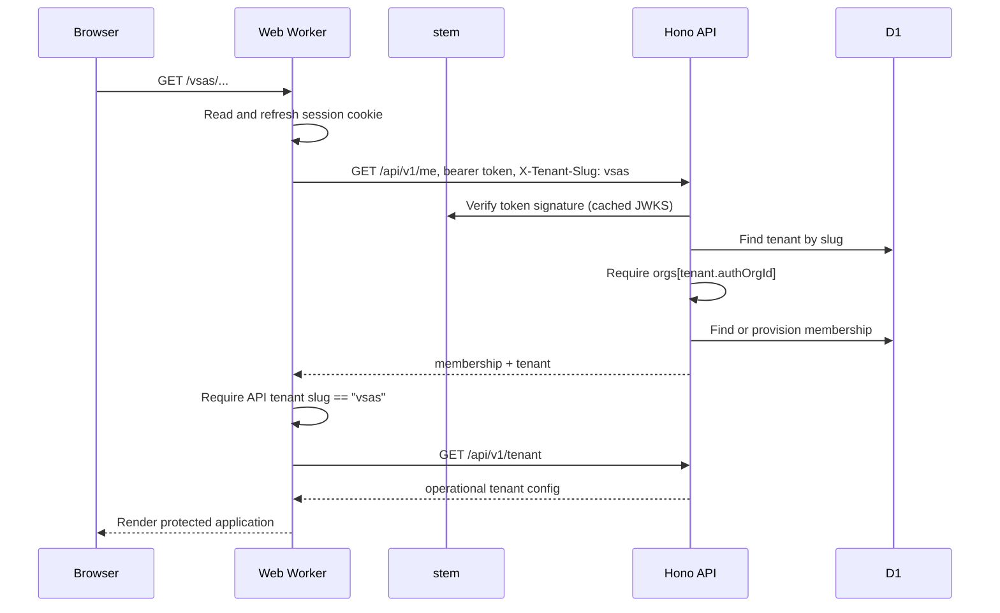
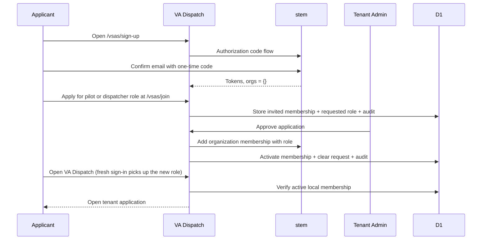

# Authentication and Multi-Tenancy

VA Dispatch signs people in with stem, the shiftbloom account service. stem is a standard OpenID Connect provider. A stem organization is the identity-side representation of a Virtual Airline, and a `tenants` row is the application-side representation. Every protected request resolves both before it can access business records.

## Sign-in

The web Worker is a confidential OIDC client. It uses the authorization code flow with PKCE (`S256`) and `client_secret_basic`:

1. `/:slug/sign-in` and `/:slug/sign-up` link to `/auth/login?returnTo=…`.
2. `/auth/login` stores the PKCE verifier, `state`, `nonce`, and the return path in a sealed, short-lived `__Host-va-auth` cookie. It then redirects to stem's authorize endpoint with scopes `openid profile email offline_access orgs` and `resource=<AUTH_AUDIENCE>`.
3. stem signs the person in with a one-time email code. A first sign-in creates the account.
4. `/auth/callback` checks `state`, exchanges the code (again with `resource`), verifies the ID token and its `nonce`, and writes the app session.

The app session is one encrypted, HttpOnly, `SameSite=Lax` cookie, `__Host-va-session`. It holds the access token, the rotating refresh token, the ID token (for sign-out), and the display profile. AES-256-GCM keys are derived from `AUTH_SESSION_SECRET` with HKDF. stem's own session cookie stays on stem's host.

Access tokens are EdDSA JWTs (`typ: at+jwt`) for the API resource and live 10 minutes:

- **Pages:** the proxy refreshes the token shortly before it expires. Server components cannot write cookies, so this happens before rendering.
- **Browser:** code fetches its token from `/auth/token`. That route refreshes when needed, rejects cross-site requests through Fetch Metadata, and caches the token in memory.
- **Refresh tokens rotate,** so every refresh writes the new one back.

`POST /auth/logout` clears the app session and redirects to stem's `end_session_endpoint` with `id_token_hint`.

stem does not allow loopback redirect URIs, so local development uses the API's development bypass (below) instead of signing in.

## Tenant identity chain



A `403` from `/me` sends the person to `/:slug/join`. The web application makes no business-data reads if the URL, the `/me` tenant, and the `/tenant` result do not agree.

## API authentication

Production requests use:

```http
Authorization: Bearer <stem access token>
X-Tenant-Slug: vsas
```

The API verifies the token against stem's JWKS (from OIDC discovery, or `AUTH_JWKS_URL`). It checks `iss` = `AUTH_ISSUER`, `aud` = `AUTH_AUDIENCE`, and `typ` = `at+jwt`. Then it requires:

- a subject (`sub`, a stable stem user ID);
- a tenant: the one named by `X-Tenant-Slug`, or the only organization in the token when the header is absent;
- an entry for that tenant's organization in the `orgs` claim (`{ "<stem org id>": "<role>" }`); and
- an active local membership.

The token carries no active organization. The API decides which tenant a request is about and checks membership in the `orgs` map, so one account can belong to several Virtual Airlines.

The narrow `GET|POST|DELETE /membership-application` flow is the exception to the organization requirement. It still verifies the token subject, but resolves the requested tenant from the server-known URL slug and never accepts a tenant ID or user ID from the browser. The applicant's display name and email verification come from the token's `name`, `email`, and `email_verified` claims. It exposes no operational data and marks every response `private, no-store`.

The configured `VSAS_AUTH_ORG_ID` is a narrow bootstrap exception: if that exact organization appears in a token but is missing from the database, the API can create or repair the tenant with slug `vsas`. Arbitrary organizations are never auto-created as tenants.

## Membership provisioning and roles

On first access to a registered tenant, the API atomically creates an active pilot or dispatcher membership, using the organization role assigned through the native tenant administration flow, plus a self-provision audit event. An organization admin or owner role does not grant routine application-admin privilege during authentication. Admin authority comes from the audited VA Dispatch control plane. The only recovery exception promotes a verified organization admin or owner when the tenant has no active application administrator.

stem organization roles map as follows (a legacy `org:` prefix is ignored):

```text
admin / owner  -> admin
dispatcher     -> dispatcher
pilot / member -> pilot
unknown        -> pilot
```

stem must list `dispatcher` and `pilot` in its `ORG_ROLES`.

Role rank is hierarchical:

```text
pilot = 1, dispatcher = 2, admin = 3
```

`requireRole("dispatcher")` therefore permits dispatchers and administrators. `requireRole("admin")` permits administrators only.

The stored local membership role and status are authoritative after provisioning. Active role changes are synchronized to the stem organization before the local change commits. A disabled or pending local membership is never reactivated merely because a stale organization membership exists. Role changes reach the access token at the next refresh, within 10 minutes.

## Directory API

Invitations, member sync, role changes, and removals use stem's directory API. The API Worker gets a five-minute token with its own client credentials (`grant_type=client_credentials`, `scope=directory`, `resource=<issuer>/api/v1`), using `AUTH_CLIENT_ID` and `AUTH_CLIENT_SECRET`, and caches it. A client only sees organizations of its own app.

The native tenant administration flow provides:

- direct pilot/dispatcher invitations, which stem emails, with the tenant's configured lifetime (1 to 30 days);
- pilot/dispatcher applications from signed-in users with manual admin review;
- application approval, which adds the organization membership in stem before local access becomes active;
- rejection without granting organization membership;
- role/status changes with existing assigned-work and last-admin guards;
- member removal, which disables local access first and then removes the stem membership, returning an explicit retry state if stem is unavailable; and
- `/members/sync`, an admin-only, fully paged reconciliation tool with explicit partial-failure reporting.

Membership statuses are:

- `active`: may authenticate;
- `invited`: rejected by the API until activated; and
- `disabled`: rejected by the API.

For the tenant-level self-service application, `invited` means a pending application and `role` records the requested pilot/dispatcher role. Approval activates that role; rejection closes the request atomically. A returning disabled member may apply again, but still needs another explicit decision.

## Signup and approval sequence



Direct invitations skip the application decision. stem emails the invitation and, after acceptance, returns the person to `/:slug`. The accepted organization role is provisioned on first tenant access or the next directory sync when no local record exists. An existing pending or disabled local record remains inactive for explicit administrator review. A pending invitation is not yet an organization membership and therefore cannot be imported by sync.

## Resource authorization

Tenant isolation and role authorization are separate checks.

| Resource                 | Pilot visibility    | Dispatcher/admin visibility      |
| ------------------------ | ------------------- | -------------------------------- |
| Schedule requests        | Own membership only | All records in active tenant     |
| Flights                  | Assigned pilot only | All records in active tenant     |
| Members                  | No list access      | All memberships in active tenant |
| Dispatch board and inbox | None                | Active tenant only               |
| ACARS messages           | None                | Active tenant only               |
| Tenant details           | Current tenant      | Current tenant                   |

Pilot decisions also check ownership of the individual flight. All repository calls include the authenticated tenant ID; UUID knowledge alone does not grant cross-tenant access.

## Passkey step-up for sensitive admin actions

Some admin actions need a passkey sign-in to stem from the last ten minutes (`AUTH_STEP_UP_SECONDS`), based on the access token's `auth_method` and `signed_in_at` claims:

- changing a member's role or status, and removing a member;
- saving or clearing the Hoppie ACARS credentials;
- processing and exporting privacy requests, approving a retention policy, running or retrying a real (deleting) retention run, and releasing a legal hold;
- exporting the audit log.

When the sign-in is too old, the API answers `403 STEP_UP_REQUIRED` with `details.stepUp.reason: "stale"`. The web app sends the person to `/auth/login?step_up=1`, which asks stem to confirm them again (`prompt=login`, `acr_values=phr`, passkey offered first) and returns to the same page, where they retry the action. The callback only accepts a step-up from the account that is already signed in. An email code never passes: right after signing in with one, the reason is `"passkey"` and the app shows that the person needs to add a passkey on their stem account page first.

## Static web tenants and database tenants

The backend schema and API are tenant-scoped, but `apps/web/src/lib/tenant.ts` currently contains one static branding entry: `vsas`.

Adding another Virtual Airline requires all of the following:

1. Add and test its static web tenant configuration and brand assets.
2. Have the stem operator create an organization for the app with the matching slug.
3. Create the database tenant mapping to that stem organization ID.
4. Configure legal/operator implications for the deployment.
5. Configure a distinct Hoppie ground station if ACARS is used.
6. Add tenant-isolation tests covering the new path.

Creating only a database row is not enough; the web rejects unknown URL slugs before loading identity.

## Development authentication bypass

When `AUTH_DEV_BYPASS=true` and `NODE_ENV` is not `production`, the API accepts:

```http
X-Dev-User-Id: user_dev
X-Dev-Org-Id: org_vsas_dev
X-Dev-Role: admin
```

Defaults are supplied for missing headers, but the referenced tenant must already exist. The bypass upserts a development membership and uses its stored role.

The bypass is hard-disabled in production. It must still never be configured there.

The fast browser suite uses `NEXT_PUBLIC_E2E_ROUTE_FIXTURE_MODE`; the integrated suite uses `E2E_FIXTURE_MODE`, a high-entropy `E2E_FIXTURE_SECRET`, an exact disposable-database confirmation, and `NEXT_PUBLIC_E2E_FIXTURE_MODE`. All fixture modes are rejected in production and are not deployment authentication.

## Public routes

The following paths never read the session:

- `/impressum`
- `/imprint` (redirect)
- `/privacy`
- `/datenschutz` (redirect)

Health and API documentation are public at the API service; business API routes remain authenticated.

## The bot check is not authentication

The Cloudflare bot-score check runs before authenticated business routes on mutating requests. It is an abuse-control layer, not an identity or role substitute. A request must pass the bot check where applicable and then pass token verification, tenant resolution, and authorization.

Internal cron routes are excluded from the bot check because they use `CRON_SECRET`. Development seed and integrated fixture routes are independently hard-disabled in production and use separate non-production authority.

## Invariants for contributors

- Never infer tenant from an untrusted body, query parameter, or resource ID. The `X-Tenant-Slug` header only selects a tenant; the `orgs` claim decides whether the caller belongs to it.
- Derive the tenant from authenticated context and include it in every repository predicate.
- Do not load business data before the web tenant agreement check completes.
- Keep role mapping conservative; unknown roles remain pilots.
- Test both unauthorized role access and cross-tenant UUID access for new resources.
- Do not return client secrets, session keys, Hoppie credentials, or encrypted values in serializers.
